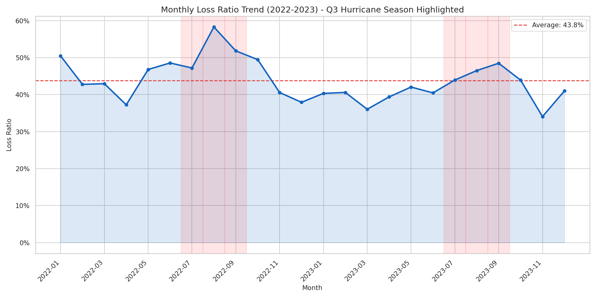
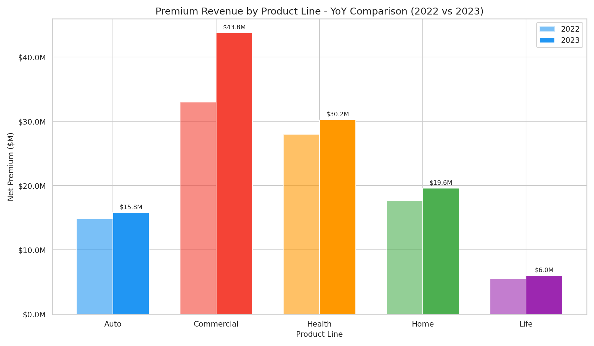
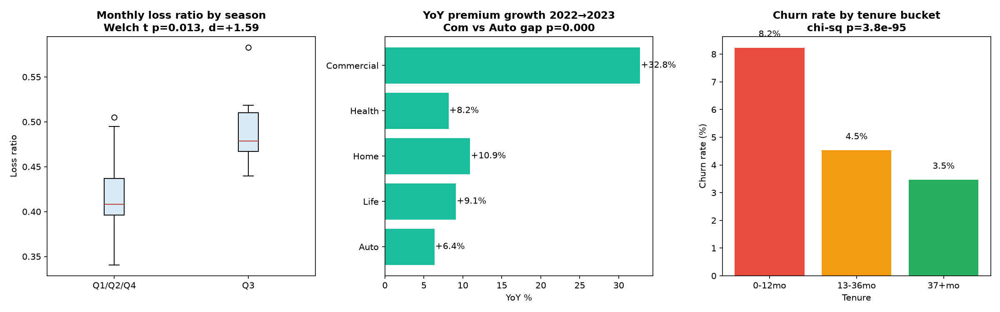
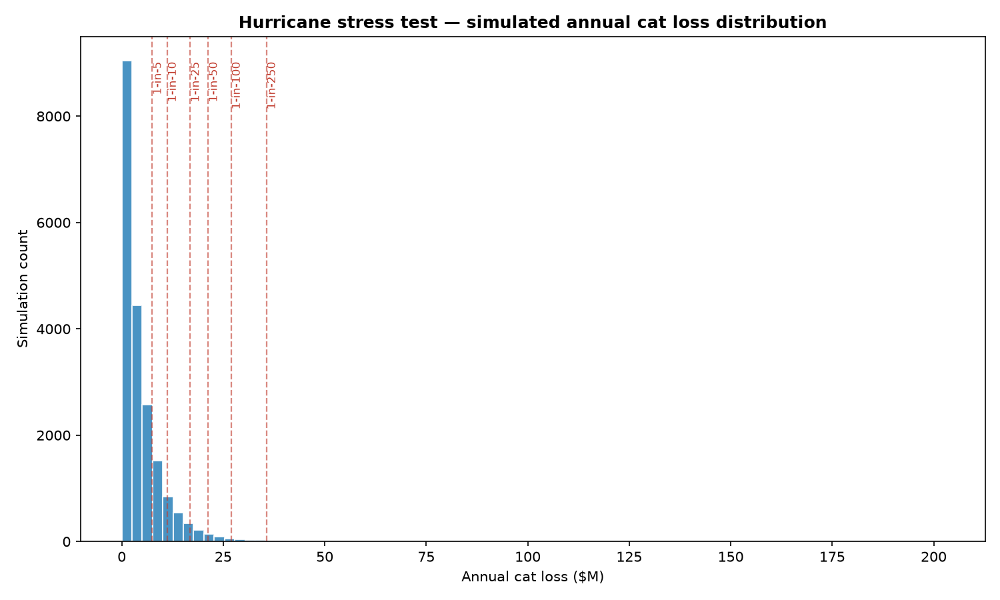

# Insurance Portfolio Analytics (synthetic data)

[](https://github.com/AwpDemon/catastrophe-loss-analysis/actions/workflows/analysis.yml)
[](LICENSE)


> **Synthetic data.** "KAT Insurance Co." is fictional. All 68,211 transactions are generated by
> `data/generate_sales_data.py` (seed 42), and the generator deliberately plants some patterns (a
> June-November hurricane claim factor, extra for Florida and the Gulf Coast, and a 2023 tilt toward
> Commercial). The project is practice in finding, testing and stress-testing those patterns with Excel
> and Python. It is not an analysis of a real insurer.

Every number below comes from a script in this repo: `analysis/08_headline_metrics.py` writes
`reports/headline_metrics.json`, and `tests/test_readme_numbers.py` fails if this README disagrees with it.

## Results

| | |
|---|---|
| Book | 68,211 transactions, 5 product lines, 8 regions (11 states), 2022-2023, $214.33M net premium |
| Portfolio ratios | loss ratio 43.58%, expense ratio 25.98%, combined ratio 69.56% |
| Q3 loss-ratio spike | Q3 49.0% vs 41.8% for the rest of the year (**+7.2 points**); monthly Welch's t = +3.19, **p = 0.013**, Cohen's d = +1.59, bootstrap 95% CI on the difference **[+0.036, +0.118]** |
| Who drives the spike | Florida + Gulf Coast Home is 4.9% of premium but **11.1%** of Q3 excess claims |
| Growth | Commercial premium **+32.8%** YoY (bootstrap 95% CI +26.6% to +39.2%) vs Auto **+6.4%** (+3.5% to +9.5%) |
| Retention | churn 8.23% for 0-12 months of tenure, 4.53% for 13-36, 3.46% for 37+; χ² = 434.8, df = 2, p = 3.78e-95 |
| Hurricane stress test | 20,000-year Monte Carlo on the FL + Gulf Coast Home book: 1-in-100 loss **$26.95M (12.57% of book premium)**, 1-in-250 $35.63M (16.62%); covering the 1-in-100 above a retention equal to the exposed premium needs **$16.50M xs $10.46M** |



## What the findings mean

**Q3 is worse, and it is statistically real, but smaller than it looks on a chart.** Monthly loss ratios in
July-September average 7 points higher. With only 24 months of data, the Welch test (p = 0.013) and the
bootstrap interval (which excludes zero) are the evidence. The Florida + Gulf Coast Home book contributes
disproportionately to the excess (11% of it from 5% of premium), but most of the Q3 excess is spread across
other lines and regions, because the generator's hurricane factor applies to Home and Auto everywhere.

**Commercial is the growth line.** That growth is planted in the generator, and the bootstrap shows the
analysis recovers it with a clear gap over Auto. Commercial also has the highest underwriting margin
(48.9% vs Auto 7.5%), while Life runs at -37.9%.



**Churn halves after the first year.** First-year churn is 8.2% vs 3.5% after three years. The chi-squared
test rejects "churn is independent of tenure" overwhelmingly, but with 68K rows almost any difference is
significant, so the effect size (8.2% vs 3.5%) is the part that matters.



## Hurricane stress test

`analysis/07_cat_stress_test.py` simulates 20,000 hurricane seasons: event count ~ Poisson(2.1) and per-event
loss ~ LogNormal(ln 0.12, 1.1) × the exposed premium ($10.46M of FL + Gulf Coast Home). **Both distributions
are assumptions I chose for illustration**, not calibrated to landfall history or to a vendor catastrophe
model, so the PMLs show the method rather than a real risk estimate.

| Return period | Annual loss | % of book premium |
|---|---|---|
| 1-in-10 | $11.19M | 5.22% |
| 1-in-100 | $26.95M | 12.57% |
| 1-in-250 | $35.63M | 16.62% |

If the company retained losses up to the exposed premium ($10.46M), covering the 1-in-100 would need a
$16.50M xs $10.46M catastrophe excess-of-loss layer, and covering the 1-in-250 would need $25.17M xs $10.46M.



## Method

Excel first: PivotTables with calculated fields (loss, expense and combined ratio, YoY growth, retention),
conditional-format heatmaps. The step-by-step Excel method is in [`reports/methodology.md`](reports/methodology.md),
and a formula-driven starter workbook is in [`excel_templates/kat_pivot_starter.xlsx`](excel_templates/kat_pivot_starter.xlsx).
Python (pandas, scipy, matplotlib) reproduces each pivot (`analysis/01-05`), tests the findings (`06`), runs the
stress test (`07`) and computes the headline numbers (`08`).

## Run

```bash
pip install -r requirements.txt
python data/generate_sales_data.py         # 68,211 synthetic rows
python analysis/06_statistical_tests.py    # Welch's t, bootstrap, chi-squared
python analysis/07_cat_stress_test.py      # Monte Carlo PMLs and layer sizing
python analysis/08_headline_metrics.py     # reports/headline_metrics.json
python -m pytest tests                     # README numbers must match the JSON
```

## Limitations and corrections

- Synthetic data with planted patterns; findings show the method works, not facts about a market.
- No claim development, IBNR or exposure base: "loss ratio" is paid claims over written net premium.
- The Monte Carlo parameters are assumptions, and the severity is expressed as a multiple of premium.
- **Corrected in October 2026** after re-running everything: the Q3 spike is 7.2 points (the README said ~15),
  Commercial growth is +32.8% (it said ~12%), first-year churn is 8.2% (it said ~23%), the FL/Gulf Home share
  of the spike is 11% (it said ~40%), and the row count is 68,211 (it said 65K/67K). Two code bugs were fixed: the
  bootstrap interval for the Q3 difference resampled the pooled data (giving an interval centered on zero), and
  the reinsurance layer was mis-sized. Hard-coded "engagement" outcomes (a "20% reporting variance resolved"
  and $100K-$1.4M impact estimates) were removed from the scripts and reports, because nothing computed them.
